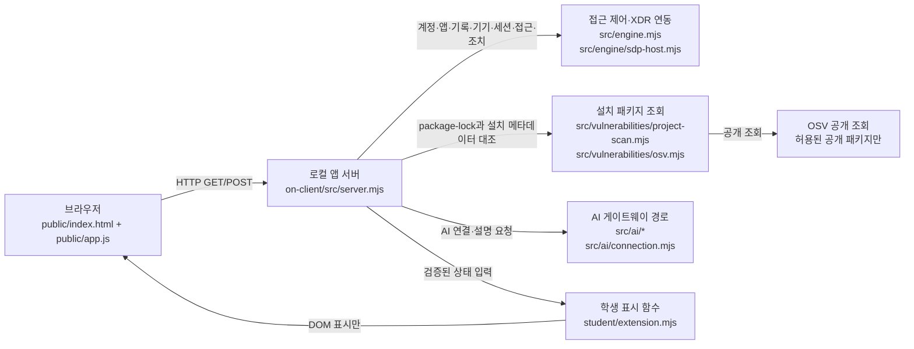

# 라요 학생 실행 설명서

이 문서는 현재 저장소에서 학생이 로컬 보안 Agent를 실행하고, 제공 화면과 학생 구현의 경계를 확인하기 위한 실행 설명서입니다. 제공 문서와 서버 설정을 덮어쓰지 않으며, 비밀번호·토큰·API 키·개인 설정 파일의 경로와 값은 적지 않습니다.

## 1. 목적과 현재 기능

라요는 로그인 상태, 업무 앱 접근 판정, 본인의 최근 보안 기록과 XDR 경보, 설치 패키지의 공개 OSV 조회 결과, 앱 내부 AI 연결·사건 설명, 보안 조치 상태를 한 화면에서 구분해 보여 주는 학생용 화면입니다.

현재 학생 구현은 `on-client/student/extension.mjs`에 있습니다. 제공 화면 `on-client/public/app.js`가 서버 응답을 검증·정리한 뒤 아래 함수에 입력을 전달하며, 학생 함수는 서버에 직접 요청하지 않고 DOM을 반환합니다.

| 학생 함수 | 입력 계약 | 학생 화면에서 확인하는 내용 |
|---|---|---|
| `renderIdentity` | `{ me, devices, sessions }` | 계정·기기·현재 세션 상태 |
| `renderDecision` | `{ status, data?, error?, appId }` | 업무 앱 접근 판정·이유·판정 시각 |
| `renderEvents` | `{ status, data?, error? }` | 최근 본인 기록·XDR 경보·필터·상세 |
| `renderStatus` | `{ devices, sessions, notifications, diagnostics, mode }` | 기기·세션·알림·도움정보 |
| `renderVulnerabilities` | `{ status, mode, data?, error? }` | 설치 패키지 정확한 버전·OSV 조회 상태 |
| `renderAiConnection` | `{ status, mode, data?, error?, checkedAt, explanationAccepted }` | 앱 내부 AI 연결 점검 |
| `renderExplanation` | `{ event, explanation, checkedAt }` | 선택한 기록에 연결된 참고용 AI 설명 |
| `renderAction` | `{ status, event, actionId, target, receipt, observation, message, confirmationExpiresAt, error }` | 준비·전달·접수·효과 관측 상태 |

학생 함수가 사용하는 주요 표식은 계약대로 유지됩니다. 기록 행은 `data-student-event-id`, 기록 상세는 `data-student-event-detail`, 패키지 행은 `data-student-package-name`과 `data-student-package-version`, 설명 성공은 `data-student-explanation-event`, 조치 상태는 `data-student-action-event`와 `data-student-action-request`를 사용합니다.

## 2. 지원 환경과 확인한 버전

| 항목 | 현재 확인값 또는 지원 범위 |
|---|---|
| 운영체제 | Windows PowerShell 환경에서 확인 |
| Node.js | 실행 확인값 `v24.19.0`; 실행 도구는 Node.js 22~24를 허용하고 24.19.0을 권장 |
| npm | 실행 확인값 `11.17.0` |
| 앱 버전 | `on-client/package.json`의 `0.2.11` |
| 외부 npm 의존성 | `package.json`에 의존성 항목 없음; 서버는 Node.js 기본 모듈을 사용 |
| 현재 lockfile | 저장소에서 `package-lock.json`을 확인하지 못함 |
| 기본 포트 | `5189` |

현재 저장소에는 `package-lock.json`이 없고 `.env.example`의 `ON_PROJECT_DIRECTORY`와 `ON_APPROVED_PUBLIC_PACKAGES`가 비어 있습니다. 따라서 기본 실행만으로 설치 패키지 OSV 조회 완료나 취약점 없음이 보장되지 않습니다. 담당자가 허용한 프로젝트 경로와 공개 패키지 목록을 준비한 경우에만 제공 서버가 그 설정에 따라 조회합니다. 학생이 의존성 버전이나 허용 목록을 임의로 바꾸지 않습니다.

## 3. 폴더와 실행 파일

현재 작업 폴더는 다음과 같습니다.

```text
C:\Users\user\Desktop\choi-bujang-secret-vault\
└─ on-client\
   ├─ package.json
   ├─ public\app.js
   ├─ public\index.html
   ├─ src\server.mjs
   ├─ src\engine.mjs
   ├─ src\engine\sdp-host.mjs
   ├─ src\vulnerabilities\project-scan.mjs
   ├─ src\vulnerabilities\osv.mjs
   ├─ student\extension.mjs
   ├─ tools\start-alekov.ps1
   └─ docs\STUDENT_RUNBOOK.md
```

학생 코드의 기본 수정 위치는 `on-client/student/extension.mjs`입니다. 제공 화면·서버·인증 설정·판정 코드는 학생 함수의 입력을 만들고 연결을 관리하므로 임의로 수정하지 않습니다.

## 4. PowerShell에서 실행

### 4.1 새 PowerShell 창과 작업 위치

기존 작업을 지우거나 덮어쓰지 말고 새 PowerShell 창을 엽니다. 다음 위치로 이동합니다.

```powershell
Set-Location "C:\Users\user\Desktop\choi-bujang-secret-vault\on-client"
```

먼저 버전과 학생 파일 문법을 확인합니다.

```powershell
node --version
npm --version
npm run check
```

정상 문법 확인 신호는 `npm run check`가 오류 없이 끝나는 것입니다. 이 검사는 학생 파일의 문법만 확인하며 서버 연결·AI 연결·OSV 조회·공식 과제 판정을 의미하지 않습니다.

### 4.2 기본 로컬 실행

실제 SDP 설정 파일을 받지 않은 기본 확인은 다음 명령으로 실행합니다.

```powershell
powershell -NoProfile -ExecutionPolicy Bypass -File .\tools\start-alekov.ps1
```

정상 시작 신호는 PowerShell에 다음과 비슷한 문장이 나오고 서버가 HTTP 200으로 응답하는 것입니다.

```text
케셰브가 켜졌습니다. 브라우저에서 http://127.0.0.1:5189/ 을 여세요.
서버가 응답한 것만 확인했습니다. AI 연결 상태는 화면에서 따로 확인해 주세요.
```

브라우저에서 [http://127.0.0.1:5189/](http://127.0.0.1:5189/)을 엽니다. 기본 실행의 `연결 없음`은 서버가 로컬에서 응답한다는 사실과 별개이며, 실제 회사 시스템 연결 성공을 뜻하지 않습니다.

### 4.3 포트가 사용 중일 때

5189 포트를 다른 프로그램이 사용 중이면 그 프로그램을 종료하지 않고 다른 포트를 지정합니다.

```powershell
powershell -NoProfile -ExecutionPolicy Bypass -File .\tools\start-alekov.ps1 -Port 5190
```

이 경우 브라우저 주소도 [http://127.0.0.1:5190/](http://127.0.0.1:5190/)으로 바꿉니다. PowerShell에 출력된 포트와 브라우저 주소를 항상 동일하게 맞춥니다.

### 4.4 선택 설정의 경계

`-SdpHostConfig`와 `-NativeHostConfig`는 서로 다른 운영 측 설정입니다. 담당자가 실제 일반 파일의 정규화된 Windows 절대 경로를 제공한 경우에만 해당 옵션을 추가합니다. 폴더 경로, 예시 경로, `담당자가 준 실제 설정 파일 경로` 같은 문구를 그대로 입력하지 않습니다.

실제 경로를 받은 경우에만 과제 화면이나 담당자 안내의 시작 명령에 그 절대 경로를 넣습니다. 실제 경로를 받지 못했다면 옵션을 생략한 기본 로컬 실행을 사용합니다. SDP 연결이 준비되지 않은 상태에서 `ENGINE_NOT_CONNECTED`나 `연결 없음`이 보이면 연결 성공으로 기록하지 않습니다. AI 연결도 앱 안의 승인·점검 절차와 담당자 권한 준비가 별도로 필요합니다.

### 4.5 종료와 재실행

기본 실행 창에서 `Ctrl+C`를 눌러 종료합니다. 다시 실행할 때는 새 PowerShell에서 4.1의 작업 위치로 이동한 뒤 같은 시작 명령을 다시 실행합니다. `-Background`를 사용한 경우 스크립트가 출력한 프로세스 번호의 Node 프로세스를 작업 관리자에서 종료한 뒤 다시 실행합니다. 서버가 자동으로 재시도하거나 자동으로 재시작한다고 가정하지 않습니다.

예제 화면만 확인할 때는 다음 명령을 쓸 수 있지만 실제 계정·SDP·AI·OSV 연결이나 과제 성취를 의미하지 않습니다.

```powershell
powershell -NoProfile -ExecutionPolicy Bypass -File .\tools\start-alekov.ps1 -Demo
```

`npm start`도 `src/server.mjs`를 실행하지만 시작 전 Node.js·포트·폴더 검사가 없습니다. 가능하면 `start-alekov.ps1`를 사용합니다.

## 5. 글로 쓴 시스템 구성도



구성도와 실제 경계는 다음과 같습니다.

- 브라우저는 로컬 앱 서버에 요청하고, 학생 함수는 전달받은 안전한 입력을 `createElement`와 `textContent`로 표시합니다.
- 로컬 앱 서버의 주요 제공 경로는 `/api/me`, `/api/apps`, `/api/events`, `/api/devices`, `/api/sessions`, `/api/access`, `/api/vulnerabilities`, `/api/diagnostics`, `/api/ai/check`, `/api/ai/explain`입니다. 조치에는 `/api/actions/prepare`, `/api/actions/execute`, `/api/actions/result`가 사용됩니다.
- 접근 제어와 XDR 기록은 `src/engine.mjs`의 엔진 경계를 거칩니다. SDP 설정을 주지 않은 기본 실행은 연결되지 않은 엔진으로 동작할 수 있습니다.
- OSV 조회는 학생 브라우저가 직접 수행하지 않습니다. 서버의 프로젝트 스캐너가 `package-lock.json`과 운영자가 허용한 공개 패키지를 대조하고, 허용된 경우에만 `src/vulnerabilities/osv.mjs`를 통해 공개 조회합니다.
- 앱 내부 AI 연결은 서버의 AI 연결 모듈과 게이트웨이 경계를 거칩니다. 연결 점검 결과는 사건 설명 성공과 같지 않으며, 학생 코드가 열쇠·토큰을 입력받거나 출력하지 않습니다.

## 6. 제공 코드와 학생 작성 코드

| 범위 | 실제 위치 | 역할 | 이번 문서에서 확인한 경계 |
|---|---|---|---|
| 제공 화면 | `on-client/public/app.js` | API 요청, 취소·세대 검사, 화면 슬롯 교체, 안전한 입력 정리 | 학생 함수에 이미 검증된 입력을 전달 |
| 제공 서버 | `on-client/src/server.mjs` | 로컬 HTTP 서버와 API 라우팅 | 학생 코드가 서버 라우트를 직접 만들지 않음 |
| 접근·XDR 엔진 | `on-client/src/engine.mjs`, `src/engine/sdp-host.mjs` | 연결된 엔진 또는 연결 없음 상태 제공 | 실제 운영 연결 성공은 별도 확인 필요 |
| 취약점 조회 | `on-client/src/vulnerabilities/project-scan.mjs`, `src/vulnerabilities/osv.mjs` | lockfile·설치 버전·허용 공개 패키지 대조 | 현재 저장소에는 `package-lock.json`이 없음 |
| AI 연결 | `on-client/src/ai/connection.mjs`, `src/ai/service.mjs` | 앱 서버를 통한 연결·점검·설명 경계 | 계정·권한·모델 준비 전에는 확인 불가 가능 |
| 학생 작성 | `on-client/student/extension.mjs` | 상태·근거·식별자·오류를 DOM 글자로 표시 | 서버 요청·비밀 입력·실제 조치 실행을 추가하지 않음 |

## 7. 확인 순서와 장애 대응

| 상황 | 먼저 확인할 것 | 복구 또는 다음 확인 | 현재 확인 범위 |
|---|---|---|---|
| 서버가 시작되지 않음 | 작업 위치가 `on-client`인지, `node --version`이 지원 범위인지 | 새 PowerShell에서 경로·Node 버전 확인 후 다시 실행 | 실행 도구와 경로를 코드로 확인 |
| 포트 사용 중 | 시작 명령의 포트 오류 | 기존 프로그램을 종료하지 말고 `-Port 5190` 등으로 재실행 | 포트 검사 로직을 코드로 확인 |
| `연결 없음`·`ENGINE_NOT_CONNECTED` | SDP 설정 옵션을 사용했는지와 담당자 제공 파일 여부 | 실제 파일이 없으면 기본 실행을 유지하고 연결 성공으로 기록하지 않음 | 기본 연결 성공은 미확인 |
| SDP 설정 파일 오류 | 파일이 폴더가 아닌 일반 파일인지, 절대 경로인지 | 담당자에게 실제 경로를 확인하고 예시·추측 경로를 입력하지 않음 | 개인 설정 파일은 미확인 |
| 취약점 `not_configured` | 프로젝트 경로·허용 패키지 설정이 준비됐는지 | 운영자가 설정을 준비할 때까지 취약점 없음으로 해석하지 않음 | 현재 설정은 비어 있음 |
| 취약점 `not_checked` | 승인된 공개 패키지 목록이 있는지 | 승인 목록을 임의로 바꾸지 않고 담당자 확인 | 현재 기본값에서 가능한 상태 |
| 취약점 `partial`·패키지 `unverifiable` | 받은 취약점 ID·수정 시각을 먼저 보존 | 전체 조회 확인 불가로 표시하고 결과를 안전으로 바꾸지 않음 | 학생 표시 함수와 모의 입력으로 확인 |
| AI 연결 실패 | 오류 코드·메시지와 앱 권한 준비 상태 | 자동 재시도하지 않고 제공 화면의 재점검을 직접 누름 | 실제 계정·권한 결과는 미확인 |
| 사건 설명 실패 | 사건 기록과 AI 설명 상태를 분리 | 기록은 유지하고 설명 실패를 접근 거부나 조치 실행으로 해석하지 않음 | 학생 표시 함수와 모의 입력으로 확인 |
| 조치 `pending`·`unknown` | ACK와 효과 관측을 구분 | 효과 없음이나 성공으로 단정하지 않고 결과 재조회 | 실제 집행은 실행하지 않음 |

## 8. 확인한 것과 미확인

이번 문서 작성 전에 확인한 항목:

- `node --version`은 `v24.19.0`, `npm --version`은 `11.17.0`이었습니다.
- `on-client/package.json`의 버전은 `0.2.11`이고 `start`, `demo`, `check` 명령이 있습니다.
- `tools/start-alekov.ps1`의 기본 포트·Node 버전 검사·HTTP 시작 확인·종료 안내를 읽었습니다.
- 현재 작업 트리에는 `package-lock.json`이 없음을 확인했습니다.
- 제공 서버의 API 경로와 학생 함수 입력 연결을 원문에서 대조했습니다.

아직 이 문서만 읽고 확정할 수 없는 항목:

- 실제 운영 SDP·XDR 시스템의 연결 성공과 계정별 기록 반환
- 실제 AI 게이트웨이 권한·모델 응답·사건 설명 결과
- 담당자가 제공해야 하는 `SdpHostConfig`·`NativeHostConfig`의 실제 파일과 권한
- 운영자가 준비하는 프로젝트 경로·허용 공개 패키지 목록과 실제 OSV 조회 결과
- 이 문서의 절차를 새 PowerShell 창에서 실제로 재실행한 화면 확인

이 설명서는 서버 응답·공식 과제 판정·실제 보안 조치 실행을 대신하지 않습니다. 지원되지 않거나 확인하지 않은 동작은 성공으로 표시하지 않습니다.
